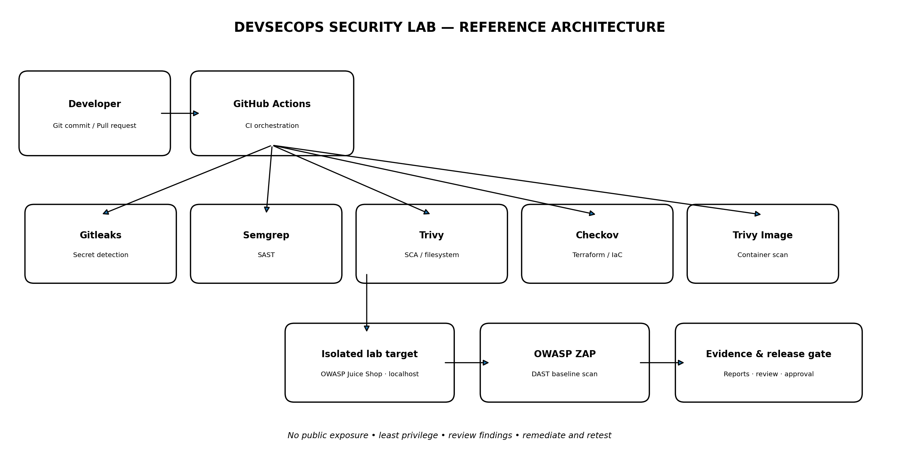

# DevSecOps Security Engineering Lab - OWASP Juice Shop

**Author:** John Uwahamen Usiabulu
**Focus:** DevSecOps · Infrastructure as Code · Application Security · CI/CD security · Security testing
**Lab type:** Defensive, isolated security engineering project

[](https://github.com/cipher0411/devsecops-juice-shop-lab/actions/workflows/ci-security.yml)
[](https://github.com/cipher0411/devsecops-juice-shop-lab/actions/workflows/terraform-security.yml)
[](https://github.com/cipher0411/devsecops-juice-shop-lab/actions/workflows/dast-security.yml)
[](https://github.com/juice-shop/juice-shop)
[](LICENSE)

> An end-to-end DevSecOps pipeline around **OWASP Juice Shop**, a
> deliberately insecure web application. Terraform provisions the target
> on Docker. GitHub Actions runs secret detection, SAST, SCA, container
> scanning, IaC policy-as-code and DAST. Every finding is triaged,
> high-impact ones are validated by hand, and issues in **this**
> repository are fixed and retested, with the history kept in git.

---

## Results at a glance

| Area | What was done | Result |
|---|---|---|
| **IaC policy-as-code** | 7 custom Checkov policies (`CKV2_LAB_*`), unit-tested against an insecure fixture | Baseline **6 failed** → hardened → **7/7 pass** |
| **Secrets** | Gitleaks on full git history (blocking) and on the target source | Repo: **0**. Target: 75 hits triaged; hard-coded JWT signing key confirmed |
| **SAST** | Semgrep registry packs + 2 custom rules with tests | Repo: **0**. Target: 90 findings in 923 files; **SQL injection validated** |
| **SCA / container** | Trivy on the digest-pinned image | **7 critical / 24 high**, 57 fixable → release **BLOCKED** |
| **DAST** | ZAP baseline on an internal, no-egress network | 17 alert types; CSP, CORS and open redirect validated |
| **Pipeline self-review** | Read scan *metadata*, not just findings | 4 real pipeline defects found and fixed (scope leak, silent coverage loss, root image, mis-scoped SAST) |

Full details: **[findings register](docs/findings-register.md)** ·
**[remediation log](docs/remediation-log.md)** ·
**[gate policy](docs/security-gate-policy.md)** ·
**[threat model](docs/threat-model.md)** ·
**[test plan and baseline](docs/test-plan.md)** · raw evidence in **[reports/](reports)**

## Architecture



```text
                    ┌──────────── GitHub Actions (ubuntu-24.04, ephemeral) ─────────────┐
 git push / PR ───► │ ci-security         gitleaks · semgrep · trivy fs/image · summary │
                    │ terraform-security  fmt · validate · plan · checkov · trivy config│
                    │ dast-security       terraform apply ─► ZAP ─► terraform destroy   │
                    └───────────────────────────────┬────────────────────────────────────┘
                                                    ▼  Docker engine
              juice-shop-lab-net ── juice-shop ── 127.0.0.1:3000   (loopback only)
              juice-shop-lab-scan (internal: no internet) ── juice-shop ◄── ZAP (hermetic image)
```

## Pipeline

| Workflow | Job | Tool | Gating? |
|---|---|---|---|
| `ci-security.yml` | Secrets | Gitleaks 8.30.1, full history | **Yes** |
| | SAST (this repo) | Semgrep 1.185.0: `p/github-actions`, `p/terraform`, `p/secrets`, `p/dockerfile`, lab rules → SARIF to code scanning | **Yes** |
| | Target analysis | Semgrep, Gitleaks, Trivy fs on Juice Shop source (tag + verified commit SHA) | Evidence |
| | Container + release gate | Trivy 0.76.2 on the image digest; computes PASS/BLOCKED | Evidence |
| | Summary | `scripts/summarize_reports.py` → job summary (fail-closed: missing report = "not run") | - |
| `terraform-security.yml` | Terraform | 1.17.2 `fmt -check`, `validate`, real `plan` against the runner's Docker | **Yes** |
| | Checkov | 3.4.5 built-in + `CKV2_LAB_*`, plus policy unit tests | **Yes** |
| | Trivy config | HIGH/CRITICAL misconfiguration | **Yes** |
| `dast-security.yml` | ZAP baseline | Terraform up → isolation checks → ZAP 2.17.0 → Terraform destroy (weekly + on change) | Isolation: **Yes**. Alerts: evidence |

Gating model: **gate what you own, evidence what you don't** (see
[security-gate-policy.md](docs/security-gate-policy.md)). Juice Shop is
vulnerable on purpose and is never promoted. Failing CI on its findings
would only teach people to ignore red builds.

### Pipeline hardening

- `permissions: contents: read` by default. `security-events: write` only on the SARIF job.
- Every action is pinned to a full commit SHA, and every tool image is pinned by `sha256` digest.
- `persist-credentials: false` on checkout. No `pull_request_target`, enforced by a custom Semgrep rule.
- Upstream source is fetched by tag, then the commit SHA is verified before scanning.
- Dependabot covers actions, the Terraform provider and Compose images.

## Highlights worth discussing

**1. Provider defaults are security decisions (LAB-IAC-01).** The
`kreuzwerker/docker` provider publishes ports on `0.0.0.0` unless `ip` is
set. The first Terraform draft would have exposed an intentionally
vulnerable app to the LAN. A custom Checkov policy caught it. After the
fix, a request to the host's LAN IP is refused and loopback returns 200.

**2. Policies are tested like code.** `scripts/test-checkov-policies.sh`
proves that all 7 policies **fail** on explicit bad values and **pass** on
the real config. `scripts/test-semgrep-rules.py` does the same for the
Semgrep rules, using `ruleid:`/`ok:` annotations.

**3. The DAST scanner was leaving the lab (LAB-OPS-01).** The ZAP report's
`site[]` list showed the crawler's browser had contacted **27 third-party
sites**. Scope is now enforced at the network layer: ZAP sits on an
`internal` Docker network, and CI fails if it reaches anything except
`http://juice-shop:3000`. After the fix, 28 sites became 1.

**4. …which silently cut coverage (LAB-OPS-02).** Without egress, ZAP
could not download its beta passive rules, and the scan still "passed"
with 7 fewer alert types. A hermetic scanner image (`security/zap/Dockerfile`)
restored all 17. That Dockerfile was then flagged by this repo's own Trivy
gate for having no explicit `USER` (LAB-OPS-03), and that was fixed too.

**5. Validated, not just reported.** Against the local instance only:
`' OR 1=1--` on `/rest/user/login` authenticates as `admin@juice-sh.op`
(control: 401). The open-redirect allowlist uses `includes()`, so
`?to=https://example.org/?pivot=<allowed-url>` returns a 302 to
example.org (control: 406). See
[manual-validation.md](reports/validation/manual-validation.md).

## Repository structure

```text
devsecops-juice-shop-lab/
├── .github/
│   ├── dependabot.yml
│   └── workflows/
│       ├── ci-security.yml          # secrets, SAST, SCA, container, summary
│       ├── terraform-security.yml   # fmt/validate/plan, Checkov, Trivy config
│       └── dast-security.yml        # terraform up → ZAP → terraform destroy
├── terraform/                       # Docker provider: hardened target + networks
│   ├── main.tf  variables.tf  outputs.tf  versions.tf  .terraform.lock.hcl
├── docker/docker-compose.yml        # same lab without Terraform (+ "dast" profile)
├── security/
│   ├── checkov/policies/            # CKV2_LAB_001..007 (YAML policies)
│   ├── checkov/tests/insecure/      # known-bad fixture for policy tests
│   ├── semgrep/lab-rules.yaml       # custom rules + fixtures/
│   ├── gitleaks/gitleaks.toml
│   ├── trivy/trivy.yaml
│   └── zap/                         # rules.tsv (triage) + hermetic Dockerfile
├── scripts/                         # policy/rule tests, report summariser
├── reports/                         # committed evidence from real runs
├── screenshots/
├── docs/                            # findings, remediation, policy, threat model, test plan
├── LICENSE
└── README.md
```

## Run it yourself

Requirements: Git and Docker. Everything else runs from pinned containers.

```bash
git clone https://github.com/cipher0411/devsecops-juice-shop-lab && cd devsecops-juice-shop-lab

# Option A - Terraform (what CI does)
TF='docker run --rm -v '"$PWD"'/terraform:/tf -v /var/run/docker.sock:/var/run/docker.sock -w /tf hashicorp/terraform:1.17.2'
$TF init && $TF apply -auto-approve             # -var host_port=3001 if 3000 is busy
open http://127.0.0.1:3000                      # loopback only

# Option B - Docker Compose
docker compose -f docker/docker-compose.yml up -d
docker compose -f docker/docker-compose.yml --profile dast run --rm zap   # reports/zap/

# Tear down
$TF destroy -auto-approve   # or: docker compose -f docker/docker-compose.yml down
```

The step-by-step commands for each scanner are in [docs/test-plan.md](docs/test-plan.md#reproduce-locally).

**Isolation rule:** only scan the local instance you started. Never scan the
public Juice Shop demo, third-party sites, or any system without written
authorisation.

## Portfolio checklist

- [x] Repository, README and architecture diagram committed
- [x] Local Juice Shop runs on loopback only (verified from the LAN IP)
- [x] GitHub Actions workflows committed and executed
- [x] Gitleaks, Semgrep and Trivy reports retained (`reports/` + workflow artifacts)
- [x] Terraform validation and Checkov scan completed (with custom, tested policies)
- [x] ZAP baseline report generated against the local target
- [x] Findings triaged; several remediations retested with before/after evidence
- [x] Least-privilege workflow permissions; actions and images pinned
- [x] All claims in this README reflect the repository state

## Interview talking points

- Why "gate what you own, evidence what you don't" beats one global threshold.
- SAST vs SCA vs secrets vs IaC vs DAST: what each one can and cannot see,
  and how SAST + DAST corroborated the open redirect.
- Why a scanner exit code is not a risk assessment (LAB-SAST-06/07 are true
  positives with low exploitability; LAB-ZAP-06 is a false positive).
- Enforcing rules of engagement with network isolation instead of tool configuration.
- Why the pipeline itself is an attack surface: pinned SHAs and digests,
  token scope, `pull_request_target`.
- How to show a fix is closed: before/after reports in git history.

## References

[OWASP Juice Shop](https://github.com/juice-shop/juice-shop) ·
[GitHub Actions security hardening](https://docs.github.com/actions/security-for-github-actions/security-guides/security-hardening-for-github-actions) ·
[Terraform Docker provider](https://registry.terraform.io/providers/kreuzwerker/docker/latest/docs) ·
[Semgrep](https://semgrep.dev/docs/) · [Gitleaks](https://github.com/gitleaks/gitleaks) ·
[Trivy](https://trivy.dev/) · [Checkov custom policies](https://www.checkov.io/3.Custom%20Policies/YAML%20Custom%20Policies.html) ·
[ZAP baseline scan](https://www.zaproxy.org/docs/docker/baseline-scan/)

---

*This is an independent learning and demonstration lab. OWASP Juice Shop
remains the property of its maintainers and is used under its licence. No
production environment was deployed, and nothing here claims certification.*
